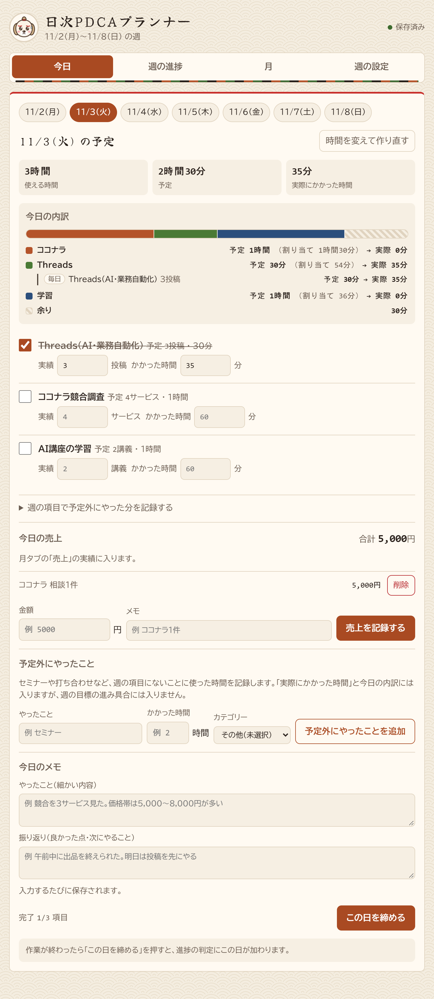
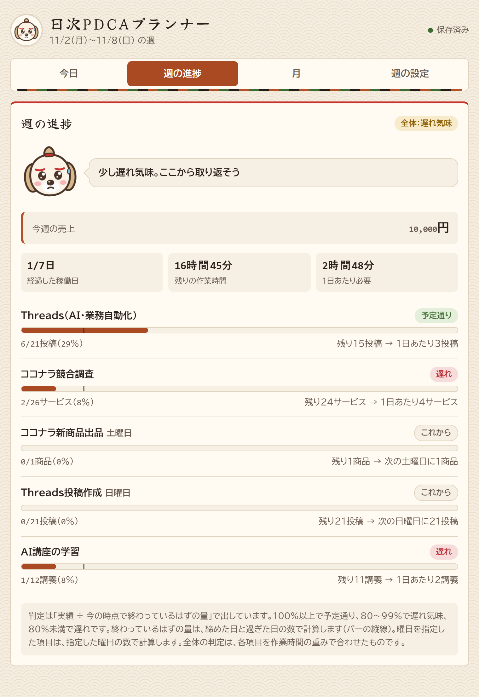
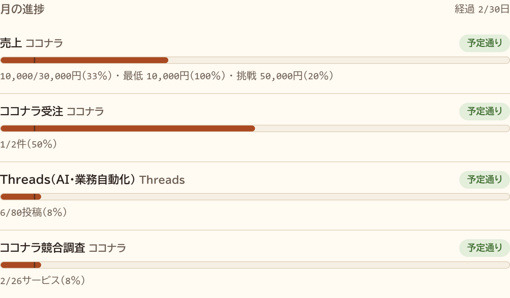
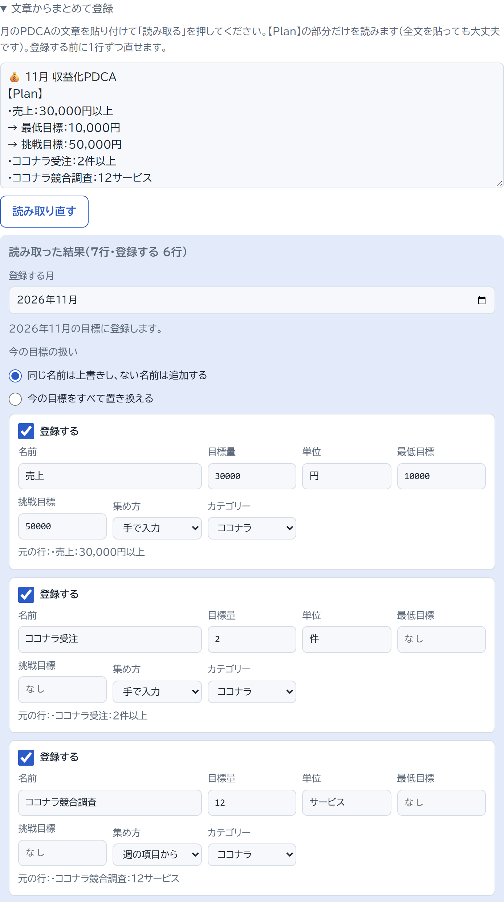
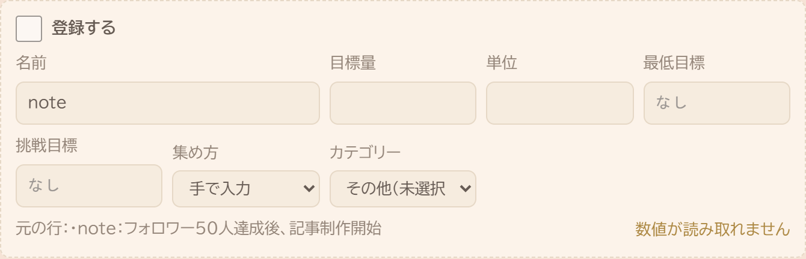
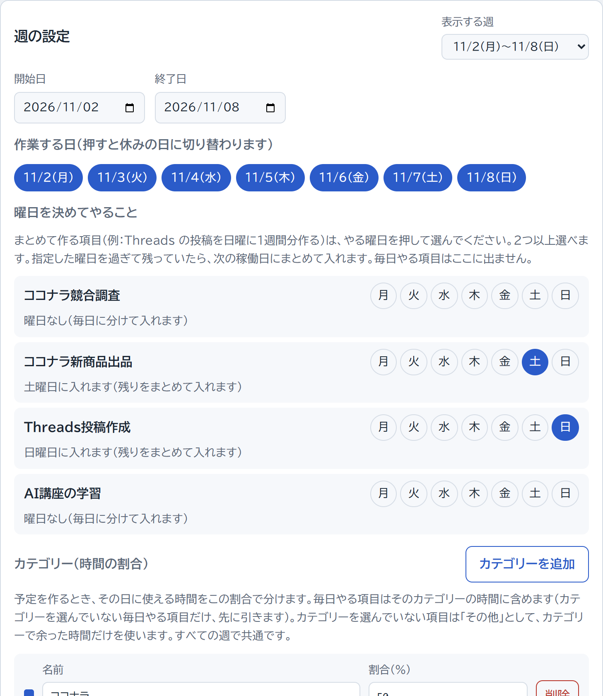
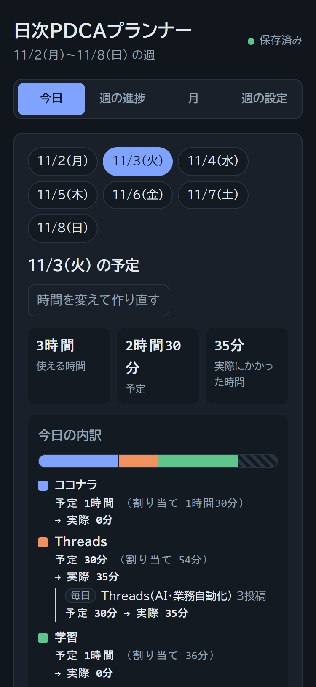
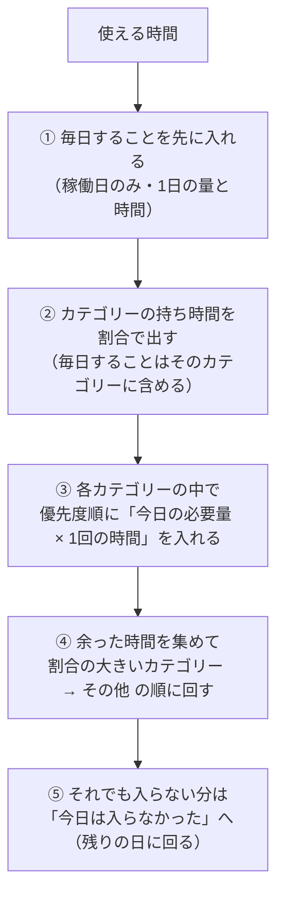

# 日次PDCAプランナー

**月・週のPDCAで決めた目標を、「今日やること・量・時間」に自動で落とし込む個人用ツール**

その日に使える時間を入れるだけで、今日の予定ができます。終わったら実績を入れると、週の目標に対して「予定通り／遅れ気味／遅れ」が分かります。



| 項目 | 内容 |
|---|---|
| 種類 | 個人用の Web ツール（ブラウザで `index.html` を開くだけで動く） |
| 技術 | HTML / CSS / JavaScript（ビルドなし・ライブラリなし）、localStorage、Node.js 標準のテスト（`node:test`） |
| 規模 | 本体 約2,500行 ／ 自動テスト 78件 |
| 開発期間 | 2026-10-29 〜 2026-11-03 |
| 開発の進め方 | AI（Claude Code）とのペアプログラミング。要件・計算ルールを先に文章で決め、Plan の確認 → 段階ごとの実装 → テスト → ブラウザ確認 → コミット の順で進めた |

---

## 目次

- [作った理由](#作った理由)
- [できること](#できること)
- [画面](#画面)
- [予定の割り振りのしくみ](#予定の割り振りのしくみ)
- [工夫したところ](#工夫したところ)
- [技術構成](#技術構成)
- [テスト](#テスト)
- [開発の進め方](#開発の進め方)
- [開発の流れ](#開発の流れ)
- [使い方](#使い方)
- [今後やりたいこと](#今後やりたいこと)

---

## 作った理由

副業（ココナラの出品、Threads の発信、学習）を、毎月・毎週 PDCA で計画しています。ただ、計画を立てたあとに次の3つの困りごとがありました。

1. **「今日なにを、どれだけやるか」を毎朝考え直していた**
   週の目標が「Threads 21投稿・競合調査 12サービス」のように決まっていても、今日の残り時間で何件やるかは、毎日頭の中で計算していました。
2. **遅れに気づくのが週末になる**
   週の途中で予定より遅れていても、週末に振り返るまで気づけませんでした。
3. **時間の配分が偏る**
   やりやすい作業（投稿）ばかり進み、時間のかかる作業（出品・学習）が後回しになっていました。

そこで、**目標を立てるところは今までどおり自分でやり、「日に落とす計算」と「進み具合の判定」をツールに任せる**ことにしました。AI や外部 API は使わず、決まった計算ルールで毎回同じ結果が出るようにしています。

---

## できること

| 機能 | 内容 |
|---|---|
| **今日の予定を自動で作る** | 使える時間（例：3時間）を入れると、週の残り量・残り日数・優先度から、今日やる量と時間を出す。入りきらない分は「今日は入らなかった」として残りの日に回す |
| **毎日すること** | 「Threads を毎日3投稿・30分」のような項目は、稼働日に必ず先に入れる |
| **カテゴリーと時間の割合** | 「ココナラ 50%・Threads 30%・学習 20%」のように決めると、その割合で時間を分けてから各カテゴリーの中で優先度順に入れる。余った時間はほかのカテゴリーに回す |
| **曜日指定** | 「Threads の投稿は日曜に1週間分まとめて作る」のように、やる曜日を決められる（2つ以上も可） |
| **今日の内訳** | 予定時間をカテゴリーごとに帯グラフで出し、実績を入れると「予定 → 実際」を並べる |
| **実績の記録と締め** | 項目ごとにチェック・量・時間を入れ、「この日を締める」で進捗の判定に入れる。セミナーなど週の項目にないことも「予定外にやったこと」として記録できる |
| **週の進捗** | 項目ごとに「今の時点で終わっているはずの量」と比べて判定する。残り量と「1日あたりあと何」も出す |
| **月の進捗** | 最低目標・目標・挑戦目標の3段階の達成率と、週末ごとの累計を出す。週の実績は名前で自動で集計する |
| **PDCAの文章から一括登録** | 普段書いている PDCA の文章を貼り付けると、目標・量・単位・期間を読み取り、確認画面で直してから登録する |
| **振り返り** | 日ごとの「やったこと・振り返り」メモと、月ごとの「良かった点・課題・Act」メモ |
| **1日の最低時間** | 「ツール開発は1件3時間かかるが、毎日30分は必ずやる」のように、1日の最低時間を決められる。1件を終えられない日は途中まで（0.167件・30分）を予定にし、週の進捗も時間で出す |
| **犬のキャラクター** | 週の進み具合で顔が変わって動く。予定より進んでいればキラキラ、予定通りなら寝ている、遅れていれば見得を切る |
| **データの保存** | ブラウザに自動で保存する。JSON ファイルで書き出し・読み込みもできる |

---

## 画面

### 1. 今日 — 予定と内訳

使える時間を入れて「予定を作る」を押すと、今日の予定ができます（上の写真）。

- 上の帯は、時間をどのカテゴリーに使うかを表しています。例では、3時間（180分）をココナラ 90分・Threads 54分・学習 36分に分けています。Threads の54分には、毎日する Threads 投稿の30分が含まれます
- 学習の項目は持ち時間の36分に入りきりません。そこで、ココナラ・Threads で余った時間を回して、2講義（60分）にしています
- 実績を入れると、カテゴリーごとに「予定 30分 → 実際 35分」が出ます

### 2. 週の進捗



- 判定は「実績 ÷ 今の時点で終わっているはずの量」で出します
  - 100%以上：予定通り
  - 80〜99%：遅れ気味
  - 80%未満：遅れ
- バーの縦線は、今の時点で終わっているはずの位置です
- 曜日を指定した項目（例：日曜の Threads 投稿作成）は、その曜日を締めるまで「これから」と出ます。週の途中で「遅れ」と出ないように、指定した曜日の数で判定しています

### 3. 月の進捗



- 売上のように幅を持たせたい目標は、最低・目標・挑戦の3つの達成率を並べます
- 判定は目標に対して出します
- 週の項目と同じ名前の目標は、週の実績を自動で合計します。売上のように手で入れたい目標は、日付・量・メモを1件ずつ入れます

### 4. PDCAの文章からまとめて登録

普段のPDCAの文章をそのまま貼り付けます。

```
💰 11月 収益化PDCA
【Plan】
・売上：30,000円以上
→ 最低目標：10,000円
→ 挑戦目標：50,000円
・ココナラ受注：2件以上
・Threads（バドミントン×メンタル）：フォロワー100人
・Threads投稿分析・改善：各アカウント4回
・note：フォロワー50人達成後、記事制作開始
【Do】
（ここから下は読まない）
```



- 【Plan】の部分だけを読みます。【Do】【Check】などの次の見出しが来たら、読むのをやめます
- 「11月」「11/2〜11/8」の見出しから期間を読みます。年は今日にいちばん近い年にします
- 「30,000円以上」から量 30000・単位「円」を読み、「→ 最低目標」の行はすぐ上の目標の最低目標にします
- 読み取りにくい書き方も、名前を補って読みます
  - 「フォロワー100人」→ 名前「Threads（バドミントン×メンタル）フォロワー」
  - 「各アカウント4回」→ 名前「Threads投稿分析・改善（各アカウント）」
- 数値として読めない行は、チェックを外して理由を出します。登録する前に1行ずつ直せます



週の文章も同じ形で登録できます。前の週の同じ名前の項目があれば、カテゴリー・毎日やる・曜日などの設定を引き継ぎます。そのため、毎週付け直す必要がありません。

### 5. 週の設定 — 曜日とカテゴリー



- 「作業する日」を押すと、その日が休みの日に切り替わります
- 「曜日を決めてやること」で、項目ごとにやる曜日を選びます
- カテゴリーの割合の合計が100%でないときは、注意を出します。計算では、合計に対する比で分けます

### 6. スマホ・ダークモード



主に PC で使いますが、幅375pxのスマホでも横スクロールが出ないようにしています。OS の設定に合わせて、ライトモードとダークモードを切り替えます。

---

## 予定の割り振りのしくみ

計算ルールは [docs/requirements.md](docs/requirements.md) に文章で決めてから実装し、例をそのままテストにしています。



**今日の必要量** は、`ceil(週の残り量 ÷ 残りの稼働日数)` で出します。遅れた分は、自動で残りの日に分けて入ります。

**例**（テストで確認しています）：使える時間3時間、カテゴリー「ココナラ 50%・Threads 30%・学習 20%」の場合

| 条件 | 各カテゴリーの持ち時間 |
|---|---|
| 毎日すること30分がカテゴリーなし | 残りの150分を 75分・45分・30分 に分ける |
| 毎日すること30分が Threads | 180分を 90分・54分・36分 に分け、Threads の54分に毎日の30分を含める |
| 学習の毎日することが60分（学習の割合の分36分を超える） | 学習は60分。残りの120分を 75分・45分 に分ける |

学習の項目が20分しか使わないときは、余った10分を、ココナラ・Threads で入りきっていない項目に回します。

---

## 工夫したところ

### 計算を画面から切り離し、テストで固定した
計算はすべて `src/planner.js`（予定・判定・集計）と `src/parser.js`（文章の読み取り）に置いています。どちらも、画面や保存に触らない純粋関数だけで書きました。同じファイルをブラウザでも Node.js のテストでも読めるので、画面を開かずに計算を確かめられます。要件書に書いた例は、そのままテストにしています。

### 「ファイルを開くだけ」で動くようにした
ビルドツールもサーバーも使わず、`index.html` をダブルクリックすれば動きます。`file://` で開くと `<script type="module">` が読み込めないため、通常の `<script>` を順番に読み込んでいます。各ファイルは、`window` と `module.exports` のどちらにも関数を公開する形にしました。

### データを消さないための工夫
- **データの形の移行**：保存データに `schemaVersion` を持たせ、形を変えるたびに読み込み時の移行処理を書きました（v0 → v4）。古いデータを読んでも、週の実績や月の目標は消えません。移行もテストで確かめています
- **読めないデータの退避**：読めなかった保存データは、上書きする前に別のキーへ退避します。退避にも失敗したときは保存を止めます
- **実績を引き継ぐ**：一括登録で「今の目標をすべて置き換える」を選んでも、同じ名前の目標・項目は ID を引き継ぎます。そのため実績は残ります。消える項目は、確認画面に「実績あり」と出します
- **誤操作の防止**：削除は2回押しで確定します。読み込みで上書きする前には、画面の中で確認を出します

### 正しく数えるための細かい決まり
- 日付は `YYYY-MM-DD` の文字列で扱い、ローカル時刻で計算します。`toISOString()` は UTC になって日付がずれるので使っていません
- 予定の行には、作った時点の区分（毎日やる項目か・カテゴリー）を残します。あとで項目のカテゴリーを変えても、過去の内訳は変わりません
- 週の期間を短くしても、期間外の実績はデータに残します。計算では期間の中だけを数えるので、期間を戻せばまた数えます
- 月をまたぐ週（10/26〜11/1）は、実績の日付で月に振り分けます

### 使う人が迷わない画面
- ボタンの文言は、押した結果が分かる言葉にしました（「予定を作る」「この日を締める」「時間を変えて作り直す」）
- 週や項目がまだないときは、次に何をすればよいかを出します
- 画面に出す文字列はすべてエスケープしています。項目名に `<b>` などが入っても表示が壊れません
- ライトモード・ダークモードの両方で読める色を CSS 変数で決めました。カテゴリーの色は6色をくり返し、「余り」は縞模様にして、色だけに頼らない表示にしています

---

## 技術構成

| 分類 | 使ったもの |
|---|---|
| 画面 | HTML / CSS（CSS 変数・Grid・Flexbox）/ JavaScript（ES2020、ライブラリなし） |
| 保存 | ブラウザの localStorage（JSON の書き出し・読み込みでバックアップ） |
| テスト | Node.js 標準の `node:test`・`node:assert`（追加のパッケージなし） |
| 画面の確認 | Playwright（Python）でブラウザを操作し、幅375px・ダークモード・コンソールのエラーを確認 |

```
index.html        画面（タブ: 今日 / 週の進捗 / 月 / 週の設定）
src/planner.js    計算ロジック（予定の割り振り・進捗の判定・月の集計）※純粋関数のみ
src/parser.js     PDCAの文章の読み取り ※純粋関数のみ
src/storage.js    localStorage の読み書き・データの形の移行・JSON の書き出し/読み込み
src/app.js        画面の描画とイベント処理
src/style.css     スタイル（ライト・ダーク両対応）
tests/            planner・parser・storage のテスト
docs/             要件定義・開発計画・画面の写真
```

読み込み順は `planner.js → parser.js → storage.js → app.js` です。画面（`app.js`）には計算式を書かず、計算は必ず `planner.js` を呼ぶようにしています。

---

## テスト

```bash
npm test
```

78件のテストで、次のことを確かめています。

- **予定の割り振り**：要件書の例（2時間・5時間のときの中身）、カテゴリーの持ち時間と余りの回し方、毎日すること、曜日指定、休みの日
- **進捗の判定**：予定通り・遅れ気味・遅れの境目、曜日指定の項目の判定、月をまたぐ週の振り分け
- **文章の読み取り**：11月の例文の12目標すべて、【Do】で読むのをやめること、年の決め方（今日が 2027-01-10 なら「12月」は 2026-12）、年をまたぐ週
- **保存**：v0〜v3 のデータの移行で中身が消えないこと、壊れたデータの退避、形の違うファイルを読み込まないこと

---

## 開発の進め方

AI（Claude Code）とペアプログラミングで作りました。自分の役割は、何を作るか・どう計算するかを決めること、出てきた Plan を判断すること、実際に使って直すことです。

1. **要件と計算ルールを先に文章にする**：[docs/requirements.md](docs/requirements.md) に、機能・計算式・データの形・テストに使う例を書く
2. **大きな変更の前に Plan を出してもらう**：決めるべき点（例：「その他」のカテゴリーに時間をどう渡すか、休みの日に毎日やる項目を入れるか）を挙げてもらい、自分で選ぶ
3. **段階ごとに実装する**：計算とテスト → データの移行 → 画面 → 連携 の順に進め、段階ごとに `npm test` を通す
4. **ブラウザで確かめる**：実際の画面を操作し、幅375px・ダークモードで崩れないかを見る
5. **使ってみて直す**：たとえば、使ってみて「毎日やる Threads 投稿は、Threads の割合の中に含めるべきでは」と気づき、割り振りのルールを変えた

プロジェクトの決まり（技術の制約・コーディングルール・画面のルール）は [CLAUDE.md](CLAUDE.md) にまとめています。開発の手順は [docs/development_plan.md](docs/development_plan.md) にあります。

---

## 開発の流れ

| 日付 | 内容 |
|---|---|
| 2026-10-29 | 最小版：週の目標の登録、今日の予定、実績の記録、週の進捗、データのバックアップ。月の目標と週末ごとの進み具合 |
| 2026-10-29 | 週の削除 |
| 2026-11-03 | PDCAの文章からの一括登録、月の最低目標（データ v3） |
| 2026-11-03 | 毎日すること・カテゴリーと時間の割合・今日の内訳（データ v4） |
| 2026-11-03 | 予定外にやったことの記録 |
| 2026-11-03 | 毎日やる項目をカテゴリーの時間に含めるよう、割り振りのルールを変更 |
| 2026-11-03 | 曜日指定（まとめて作る作業向け） |
| 2026-11-03 | 今日のメモ（やったこと・振り返り） |

---

## 使い方

1. `index.html` をブラウザで開く（Chrome 推奨。サーバーは不要）
2. 「週の設定」で週の期間を入れて週を作り、週の目標を登録する（やること・目標量・1回の時間・優先度）
   - 週のPDCAの文章があれば、「文章からまとめて登録」に貼り付けると一度に登録できる
   - 必要なら、カテゴリーの割合・毎日やる項目・やる曜日も決める
3. 「今日」で使える時間を入れて「予定を作る」
4. 終わったら実績を入れて「この日を締める」
5. 「週の進捗」「月」で進み具合を確認する

### 自分の画像を入れる（三代目の画像など）
- `personal/hero.jpg` を置くと、画面の一番上の帯に出ます（横長の画像がおすすめ。はみ出す部分は切り取られます）
- `personal/` は `.gitignore` で除外しているので、GitHub には上がりません
- 置いていないときは帯を出しません（ブラウザの開発者ツールに「見つからない」と出ますが、動作には影響しません）

### 注意
- データは、使っているブラウザの中に保存されます。ブラウザのサイトデータを消すと、データも消えます。ときどき「週の設定」の一番下にある「データを書き出す」でバックアップしてください
- 別のブラウザや別の PC とは、データが共有されません

---

## 今後やりたいこと

- **受注案件と納期**：案件ごとに納期と作業時間を登録し、通常の項目より先に割り振る。間に合わない見込みなら警告する
- **PDCA への書き出し**：週・月の実績を、今の PDCA の書式の文章で書き出す（Do／Check 欄にそのまま貼れる形）
- **月から週への自動配分**：月の目標から、週・日の量を出す（例：月93投稿 → 1日3投稿）

> 画面の写真は、見本のデータで撮ったものです。
